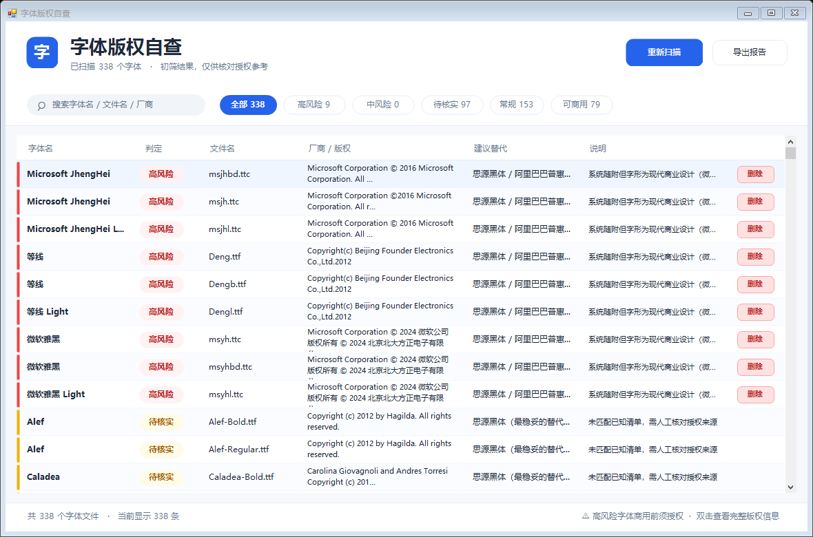

# 字体版权自查工具 · Font License Checker

> 🖥️ **系统要求：仅支持 Windows 10 / 11**（依赖 PowerShell 与 WinForms）。macOS、Linux、手机暂不支持，请勿在这些系统上下载使用。

扫描 Windows 已安装字体，读字体文件内的版权字段，按商业字库清单做风险分级，导出报告。**免费**，无需安装。

## 这是什么

一个给设计师、电商美工、广告公司、自媒体用的自查小工具。点一下「开始扫描」，它会列出你电脑里所有字体，并标出哪些在商业发布前需要授权。

## 为什么需要

很多字体能装、能用，但不能拿去商用。最典型的是**微软雅黑**和**等线**：随 Windows 预装，著作权却在方正手里，Windows 只买了预装授权，印海报、做详情页、发公众号都属于商业发布。

工具做的是把「装了什么」变成「哪些有风险」，让人在出街前心里有数。

## 截图

## 下载与使用

1. 到 [Releases](../../releases) 下载最新版本压缩包，**把整个文件夹一起解压**（不要只拷 exe）。
2. 双击 `字体版权自查.exe` 启动（或运行 `字体自查工具.bat`）。
3. 点「开始扫描」，等 10 秒左右出结果。
4. 点「导出报告」，生成一份 HTML 报告 + 一份 CSV 清单。

> 注意：`字体版权自查.exe` 是引导程序，必须和 `font-scanner.ps1`、`rules.json`、`settings.json` 放在同一个文件夹里才能正常运行。

> 💡 系统要求：仅支持 Windows 10 / 11。Mac 和手机暂不支持，请勿下载。

## 判定口径

| 分级 | 含义 |
| --- | --- |
| 高风险 | 商业字库，或权属第三方的现代字形（微软雅黑=方正兰亭黑、等线同理），商业发布需另行授权 |
| 中风险 | 订阅制字体（如 Adobe Fonts），授权通常只覆盖对应软件内使用 |
| 待核实 | 未匹配已知清单，需人工核对授权来源 |
| 常规 | 宋体/黑体/楷体/仿宋等公有领域字形及随系统分发的常规字体，正常排版输出无争议 |
| 可商用 | 开源或官方声明免费商用（部分禁止商标注册，需核对条款） |

字体详情窗口里可以看到每条判定**命中了哪条规则、匹配的原文片段、以及依据链接**，方便你自行复核。规则清单在 `rules.json`，可按 `Ctrl+R` 打开编辑。

## 局限（请务必读）

- 判定依据是字体文件内的版权字段 + 规则清单，**不是授权合同**。
- 只扫描**已安装**的字体；下载但未安装的字体文件不在扫描范围内。
- 字体改名、子集化、转曲、栅格化后无法识别。
- 「可商用」一档按官方免费商用声明整理，部分字体禁止用于商标注册。
- 本工具只做**初筛**，不构成法律意见，最终以字库厂商授权为准。

## 免责声明

本工具按现状提供，不保证检测结果完整、准确。使用者应自行核实字体授权，因使用本工具产生的任何后果由使用者自行承担。本仓库不包含任何字体文件。

## 仓库文件说明

| 文件 | 作用 |
| --- | --- |
| `字体版权自查.exe` | 启动入口（引导程序） |
| `font-scanner.ps1` | 核心脚本：扫描、判定、界面、报告 |
| `rules.json` | 判定规则清单，可按优先级/字段/排除项扩展 |
| `settings.json` | 界面开关（是否显示「规则设置」按钮） |
| `字体自查工具.bat` | 无 exe 时的备用启动脚本 |
| `app.ico` | 程序图标 |
| `screenshot.png` | 界面截图 |

程序生成的报告与字体清单是**本机数据**，不会上传，也不会包含在仓库中。

## 反馈

有问题或想补充字库清单，欢迎开 Issue，注明字体名称、文件版本和版权字段。

## 关键词

字体侵权、字体版权、微软雅黑商用、商业字体检测、字体自查、font license checker、Windows font risk scan

---

## English

A free Windows utility that scans installed fonts, reads their embedded copyright fields, and flags fonts that require a commercial license before use in posters, e-commerce pages, or marketing materials. Report export to HTML and CSV. Screening aid only — not legal advice. No font files are included in this repository.
